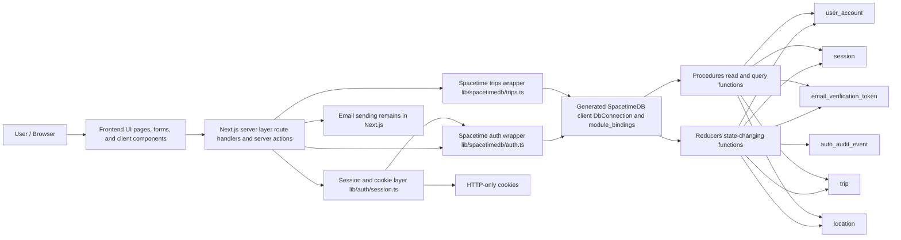
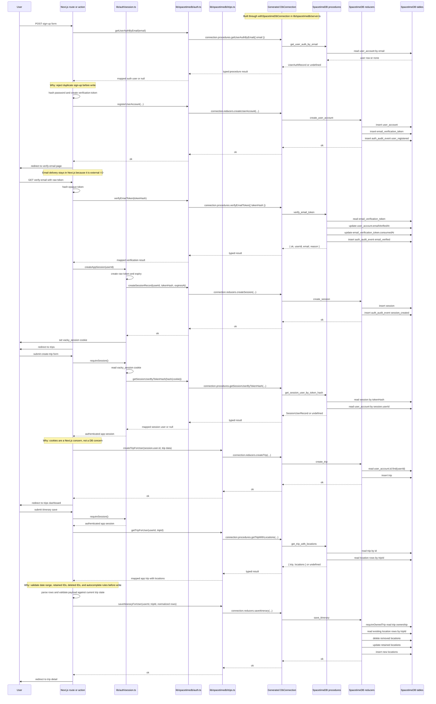

# SpacetimeDB And Next.js Flow

This page explains how Vacky uses local SpacetimeDB together with the Next.js app, why `lib/spacetimedb/auth.ts` and `lib/auth/session.ts` are separate, and what happens end to end when a new user signs up, verifies their email, creates a trip, and saves itinerary locations.

Use this page when the repo's auth/data layering feels confusing and you need the practical mental model before editing code.

## Heuristic Mental Model

Think of the runtime in six layers:

1. Browser and UI:
   pages, forms, and client components collect user intent.
2. Next.js server layer:
   route handlers and server actions validate input, orchestrate workflows, redirect, and own HTTP behavior.
3. Session/auth web layer:
   `lib/auth/session.ts` owns cookies, session token lifecycle, and current-user resolution for the app.
4. SpacetimeDB wrapper layer:
   `lib/spacetimedb/auth.ts` and `lib/spacetimedb/trips.ts` hide raw generated-client calls from the rest of the app.
5. Generated SpacetimeDB client:
   `lib/spacetimedb/module_bindings/` provides the typed `DbConnection` bridge from Next.js to the running SpacetimeDB module.
6. SpacetimeDB module:
   `spacetimedb/src/` defines tables, reducers, procedures, and shared database-side helpers.

Short version:

- Next.js owns HTTP, cookies, password hashing, email sending, redirects, and form parsing.
- SpacetimeDB owns persisted state and authoritative data mutations.
- Generated bindings are the typed bridge between them.

## Why `lib/auth/session.ts` And `lib/spacetimedb/auth.ts` Are Separate

They solve different problems.

### `lib/spacetimedb/auth.ts`

This is the database access layer for auth-related data.

It is responsible for:

- opening a SpacetimeDB connection through `withSpacetimeDbConnection()`
- calling generated reducers and procedures
- mapping raw SpacetimeDB timestamps and IDs into app-friendly shapes

Examples:

- `getUserAuthByEmail()` calls the generated procedure `connection.procedures.getUserAuthByEmail(...)`
- `createSessionRecord()` calls the generated reducer `connection.reducers.createSession(...)`
- `verifyEmailToken()` calls the generated procedure `connection.procedures.verifyEmailToken(...)`

### `lib/auth/session.ts`

This is the app-session and cookie layer.

It is responsible for:

- reading the `vacky_session` cookie
- creating raw opaque session tokens
- hashing those tokens before persistence
- writing and clearing HTTP-only cookies
- resolving the current app user from the cookie

Examples:

- `createAppSession()` creates the raw token, persists the hashed token through SpacetimeDB, then writes the cookie
- `getSession()` reads the cookie, hashes it, and asks SpacetimeDB for the matching session user
- `destroyAppSession()` revokes the stored session row and clears the cookie

### Why this split is good

- It keeps browser/HTTP concerns out of database access code.
- It keeps database query details out of cookie/session code.
- It makes auth easier to reason about:
  `session.ts` answers "who is the app user right now?"
  `spacetimedb/auth.ts` answers "how do I read or mutate auth data in SpacetimeDB?"

## How Procedures And Reducers Fit

In this repo:

- reducers are the write path
- procedures are the read/query path used by the app-facing wrappers

Practical rule:

- if the action changes persisted state, the wrapper should usually call `connection.reducers.*`
- if the action fetches a shaped result, the wrapper should usually call `connection.procedures.*`

Examples:

- `create_user_account`, `create_session`, `create_trip`, `save_itinerary` are reducers
- `get_user_auth_by_email`, `get_session_user_by_token_hash`, `get_trip_with_locations`, `list_trips_by_user` are procedures

## Architecture Diagram

## Full End-To-End Flow

This is the concrete path for:

1. sign up
2. verify email and create session
3. create trip
4. save itinerary locations

## Why Specific Functions Exist In The Middle

### Why read before write in Next.js

Functions such as `getTripForUser()` are called before `saveItineraryForUser()` so Next.js can:

- validate user-facing rules with helpful errors
- check date ranges
- ensure deleted and retained location IDs are consistent
- prevent malformed payloads from reaching the reducer

The reducer still re-checks ownership and row validity because client and server input must be treated as hostile.

### Why the reducer still validates ownership

The reducer is the last trusted write boundary.

For example, `save_itinerary` calls `requireOwnedTrip()` before any location mutation. That means even if a buggy or hostile caller skips the Next.js checks, the database-side logic still rejects writes against another user's trip.

### Why procedures are used instead of direct table reads in app code

The Next.js app never reads `ctx.db.*` directly because that database-side API only exists inside the SpacetimeDB module.

Instead the app uses generated methods like:

- `connection.procedures.getUserAuthByEmail(...)`
- `connection.procedures.getSessionUserByTokenHash(...)`
- `connection.procedures.getTripWithLocations(...)`

That keeps the app talking to SpacetimeDB through a typed network boundary rather than importing module internals.

## Practical Editing Rules

When editing this stack:

- change `lib/auth/session.ts` when the problem is cookies, session lifecycle, or current-user resolution
- change `lib/spacetimedb/auth.ts` when the problem is auth-related DB access or auth result mapping
- change `lib/spacetimedb/trips.ts` when the problem is trip/location wrapper calls, ID parsing, or app-facing mapping
- change `spacetimedb/src/modules/*/reducers.ts` when the persisted write rules need to change
- change `spacetimedb/src/modules/*/procedures.ts` when the read model shape or DB-side filtering needs to change
- change `spacetimedb/src/schema/*` when persisted fields, indexes, or tables need to change

## Related Files

- [Data And Auth](data-and-auth.md)
- [Architecture Overview](overview.md)
- [Fullstack Feature Guide](fullstack-feature-guide.md)
- [SpacetimeDB Operator Guide](../../Operator/query/spacetimedb-vacky-guide.md)
