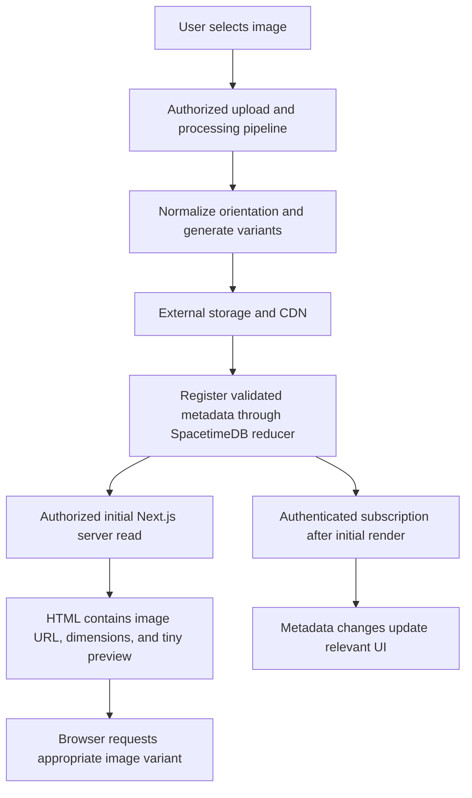

# Image Storage And Delivery Optimization

Date: 2026-10-02

Status: documented proposal for future implementation; not implemented or benchmarked

Brain impact: small; experiment, experiment index, and activity log only. Current product behavior and architecture remain as documented in the existing wiki.

## Goal

Reduce time until useful trip images appear, image transfer bytes, browser decoding work, layout shifts, and unnecessary React rendering. Evaluate SpacetimeDB as the metadata and live synchronization layer alongside externally stored image variants.

The user's request is to minimize image load time and rendering cost. This note preserves the proposed flow from that discussion so a future implementation can start from concrete steps. No claim that this is the fastest configuration has been verified.

## Current Baseline And Scope

Repository inspection during the discussion confirmed:

- Trip covers upload through UploadThing's `imageUploader` endpoint in `app/api/uploadthing/core.ts` and `app/trips/new/page.tsx`.
- `spacetimedb/src/schema/trips.ts` stores `coverImageUrl` and `imagesJson`; it has no dedicated image-asset model.
- Dashboard cards and trip-detail covers use `next/image`. Both already provide responsive `sizes`; trip detail currently uses `priority`.
- `next.config.ts` allows the current UploadThing host and has no explicit custom image loader or image format configuration.
- SpacetimeDB connections currently run through Next.js helpers and disconnect after each operation. Browser subscriptions and an authenticated browser identity bridge are not implemented.
- Local-only SpacetimeDB remains the deployment constraint for this branch.

Start with existing trip covers. A trip-photo gallery is a later consumer of the same infrastructure, not a feature added by this proposal. Do not expand the travel-memory epic implicitly: its current v1 excludes photos.

## Proposed Architecture

SpacetimeDB stores ownership, relationships, dimensions, variant references, upload readiness, and a tiny preview. External object storage/CDN serves display images and originals through cacheable HTTP requests.

If processing is asynchronous, create a processing record first and transition it to ready only after required variants exist. The diagram's ready-registration path is the simpler synchronous case; processing strategy remains an open decision.

## Step 1: Measure Existing Behavior

Before changing delivery, record a reproducible baseline for `/trips` and `/trips/[tripId]` using representative covers. Record viewport, device pixel ratio, device/browser, network and CPU throttling, source file dimensions, and file sizes.

Measure cold and warm browser caches separately; also distinguish cold and warm image-optimizer/CDN caches. Capture:

- Largest Contentful Paint and whether the cover actually is the LCP element
- Cumulative Layout Shift
- image request start, duration, transferred bytes, selected resource URL, and cache behavior
- decoded image dimensions and image decode work in a browser performance trace
- React commits when image metadata or unrelated trip state changes

Use comparable runs and report their spread. Establish numerical pass thresholds after measuring the baseline; this note does not invent a latency guarantee.

## Step 2: Generate Display Variants During Upload

Normalize orientation before removing metadata and generating variants. Decide whether originals are retained; display images should not carry unnecessary EXIF/GPS data. Keep processing in the application/upload pipeline, outside database reducers.

Suggested initial widths are hypotheses to tune against actual rendered widths and device pixel ratios:

| Variant | Starting width | Intended use |
| --- | --- | --- |
| Tiny preview | 16–32 px | Placeholder sent with metadata |
| Card | 400 and 800 px | Dashboard cards |
| Hero | 800, 1200, and 1600 px | Trip-detail cover |
| Original | Original dimensions | Explicit full-resolution access if retained |

Preserve aspect ratio; define crop behavior explicitly for cards and heroes. Do not upscale small uploads. Generate only variants justified by the current UI rather than every possible dimension.

Start with WebP at visually evaluated quality settings. Compare pre-generated AVIF on representative photos and target devices before adopting it. Smaller encoded files can still require more processing/decoding work. Keep transparency and supported input formats explicit.

The current UploadThing integration does not demonstrate this processing pipeline. Verify provider capabilities and choose processing location, resource limits, timeout behavior, and synchronous/asynchronous execution before implementation.

## Step 3: Add Structured SpacetimeDB Image Records

Introduce an `image_asset` table if variants/readiness need a dedicated model. Proposed conceptual fields, not finalized binding syntax:

| Field | Purpose |
| --- | --- |
| `id`, `ownerId`, `tripId`, optional `locationId` | Stable identity, ownership, attachment |
| `originalStorageKey` (optional) | Reference to retained original |
| Variant references and their widths/heights/formats/byte sizes | Responsive delivery manifest; initially card and hero variants |
| Source dimensions, MIME type, byte size | Validation and source metadata |
| `previewDataUrl` | Very small encoded placeholder |
| `status`: PROCESSING / READY / FAILED | Upload and processing lifecycle |
| `version`, timestamps | Replacement identity and auditability |

Separate captions/order from immutable variant identity so text edits do not change image URLs. Index the attachment/owner lookup paths needed by actual screens. Decide whether the trip references an image ID while retaining `coverImageUrl` for migration compatibility.

Keep tables private and expose authenticated projections. Validate ownership, allowed status transitions, and storage references at trusted boundaries; a supplied `ownerId` is not proof of authentication. Publish locally and regenerate generated bindings after schema/function changes.

Keep the preview payload tiny and measure its total cost across dashboard records. Base64 adds overhead. If larger inline thumbnails are evaluated, isolate them from routine metadata subscriptions and subscribe only when needed. Full-resolution images should stay outside routine SpacetimeDB subscriptions.

## Step 4: Configure HTTP Delivery And Caching

Give every variant an immutable storage identity/versioned URL. Replacing an image produces a new URL; changing a caption preserves the URL. Long-lived browser/CDN caching is appropriate only for assets whose access policy permits it.

Decide access semantics first. Private photos may require signed URLs or an authenticated delivery path; expiring signatures and shared caches need an explicit policy. Never enable public immutable caching for user-protected responses by default. Next.js's default image optimizer does not forward source authentication headers, so test protected-image compatibility before selecting that path.

Choose one transformation strategy:

1. **Incremental baseline:** retain `next/image` optimization and measure its cold/warm behavior before adding a processing service.
2. **Pre-generated delivery:** serve the prepared CDN variants using responsive image delivery or a custom Next.js image loader that maps requests to supported variants.

Avoid unnecessary second resizing/compression of prepared variants. If using a custom loader, document how it handles requested widths, formats, quality, fallback variants, and allowed hosts. If keeping the Next optimizer, document cache lifetime, format negotiation, and persistent cache behavior in the eventual hosting environment.

UploadThing is the existing storage provider; no provider replacement is selected here. CDN availability, caching headers, image transformation support, and private delivery must be verified rather than assumed.

## Step 5: Render Image References In The Initial HTML

Include the ready image URL/variant manifest, dimensions, and optional tiny placeholder in the initial authenticated server read. The browser should discover the main image without waiting for a WebSocket connection or subscription initialization.

Use fixed dimensions or an aspect-ratio container, useful alt text, and correctly scoped responsive `sizes`. A placeholder improves perceived progress but does not reduce the full image's download or decode time.

Preserve server rendering for initial dashboard/detail content. Read the bundled Next.js 16 App Router and image documentation before changing rendering boundaries or image configuration.

## Step 6: Add Bounded Authenticated Subscriptions

Add subscriptions after initial rendering to reflect ready-state transitions, replacements, captions, ordering, and deletion. Subscribe to cover metadata for the displayed dashboard batch or records for the active trip; do not download the user's entire future photo library.

Prerequisite: define how an app-owned cookie session becomes an authorized SpacetimeDB subscription identity, or choose an authenticated server forwarding design. Current sessions are not linked to browser SpacetimeDB identities. Filtering by a client-supplied user ID alone is insufficient.

Handle reconnects, sign-out/cache clearing, ownership checks, and deletion. Keep originals and larger variants on the HTTP delivery path so metadata updates do not resend photo bytes.

## Step 7: Reduce Rendering And Decoding Work

- Match requested dimensions to displayed CSS size and device pixel ratio, with measured limits for very high-density screens.
- Prioritize the actual visible LCP candidate. Lazy-load images below the fold; do not preload every dashboard card.
- Replace deprecated `priority` intentionally. Next.js 16 documents `preload`, `loading`, and `fetchPriority`; avoid conflicting loading strategies and select based on the page's LCP behavior.
- Keep asset IDs, React keys, and variant URLs stable across unrelated metadata changes.
- Use memoized image/card children only where profiling shows unnecessary commits and stable props can actually prevent them.
- For a future gallery, paginate first. Introduce virtualization only if DOM/rendering pressure justifies its complexity; preserve keyboard navigation and accessibility.
- Do not download originals for grid/card previews. Full-resolution retrieval should be an explicit user action.

Subscription freshness, HTTP caching, image decoding, and React rendering are separate costs. Improving one does not establish an improvement in the others.

## Step 8: Verify And Decide Whether To Adopt

Repeat the baseline scenarios on the same target devices, including slower mobile hardware and networks. Confirm:

- mobile cards and heroes choose appropriately sized resources
- main image discovery does not wait for subscriptions
- reserved space prevents image-induced layout shifts
- warm visits reuse eligible cached assets
- caption/metadata changes do not redownload or remount unchanged images
- replacements use new URLs; deletions disappear from open authorized views
- processing failures are visible and retryable; retries do not create duplicate ready records
- unauthorized users cannot read or attach another user's asset
- sign-out and account changes clear user-specific subscription state
- existing covers remain usable during migration and rollback

Compare LCP, transfer bytes, decoding work, and React commits against the baseline. Retain additional infrastructure only where measurements or required behavior justify it.

For implementation, run lint/build and relevant upload/browser checks. Schema/function work additionally requires local publish and binding regeneration. Reviewer/QA must assess upload, auth, SpacetimeDB, and server/client-boundary changes under the repo rules.

## Implementation Order And Rollback

1. Baseline existing covers; correct measured sizing/loading issues using the current delivery path.
2. Add processing and variant delivery for covers, preserving existing cover URLs as fallback.
3. Add structured image records, preview metadata, and readiness handling where needed.
4. Render that metadata server-side.
5. Establish authenticated subscriptions, then add bounded live updates.
6. Evaluate a gallery separately if product scope later includes it.

Use non-destructive schema additions and retain existing externally stored files during migration. Readers must fall back to the current cover URL until the variant is ready. A rollback should restore the existing read/render path without deleting originals or ready variants. Define cleanup of failed/unattached uploads and obsolete versions separately from rollout; no destructive cleanup is authorized by this experiment.

## Open Decisions Before Implementation

- Which measured bottleneck is dominant: initial HTML/data latency, cold transformation, network transfer, decode, or React work?
- Are trip images public-by-URL or protected? What are replacement/deletion and cache-expiry semantics?
- Does the existing provider support the required delivery/processing flow, or is an additional service justified?
- Where does processing run, and what are its size/resource limits, readiness and retry rules?
- Which variants, crop policies, formats, quality settings, and original-retention rules pass visual/performance checks?
- What is the cover-reference migration and orphan-file cleanup policy?
- How are authenticated subscription identities established and revoked?
- Does measured benefit justify inline previews/thumbnails compared with ordinary CDN delivery?

## Outcome, Lesson, And Promotion Rule

Outcome so far: the flow is documented; runtime behavior, provider capabilities, and performance gains remain unverified.

Working lesson: use SpacetimeDB for small authorized metadata and synchronization, and independently optimize HTTP image delivery and browser rendering. Inline storage is an option, not proof of lower latency.

Retry as a scoped cover-image performance implementation after establishing a baseline. Promote measured results and accepted architecture choices into the relevant architecture/current-surface wiki pages on the implementation branch. Record unresolved tradeoffs and browser evidence where useful; keep this experiment's proposal status until adoption is explicit.

## Evidence And References

- Source: user/assistant discussion on 2026-10-01–02 about SpacetimeDB image storage, cache use, and the eight-step optimization flow. The user requested preserving the idea in wiki experiments for future implementation.
- Repository baseline: `spacetimedb/src/schema/trips.ts`, `app/api/uploadthing/core.ts`, `app/trips/new/page.tsx`, `app/trips/trips-content.tsx`, `components/tripDetail.tsx`, `next.config.ts`, and `lib/spacetimedb/server.ts`.
- [SpacetimeDB file storage](https://spacetimedb.com/docs/tables/file-storage/): inline binary storage, subscription costs, external references, and hybrid thumbnails/originals; consulted during the discussion.
- [Next.js Image component](https://nextjs.org/docs/app/api-reference/components/image): responsive delivery, loading strategy, formats, caching, and protected-source constraints. Bundled reference: `node_modules/next/dist/docs/01-app/03-api-reference/02-components/image.md`; reviewed for the installed Next.js version during the discussion. Recheck version-specific guidance before implementation.
- [Current Surface](../features/current-surface.md)
- [SpacetimeDB And Next.js Flow](../architecture/spacetimedb-nextjs-flow.md)
- [Risks](../risks.md): RISK-002 covers missing manual/hostile-client verification; extend concrete verification scope if implementation introduces new asset boundaries.
- [Travel Memory & Traveler Profile epic](../../outputs/plans/2026-06-12-travel-memory-traveler-profile-epic.md): current v1 excludes photos; this experiment does not change that scope.
